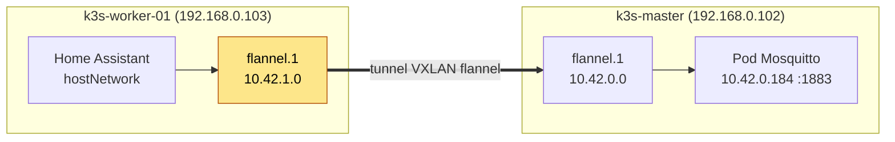
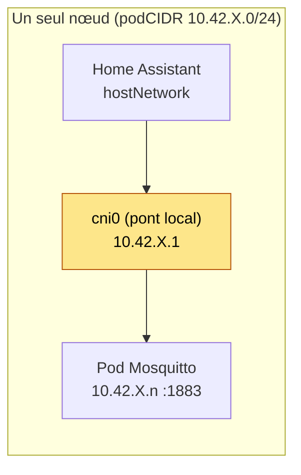
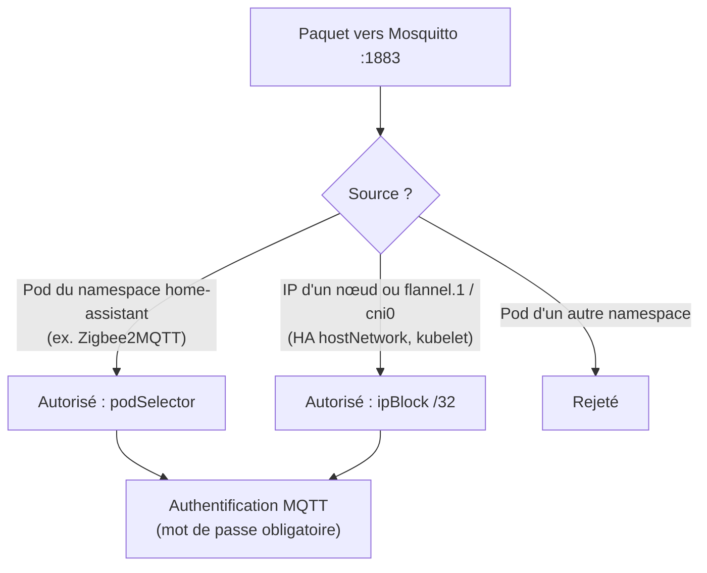

# Mosquitto : NetworkPolicy et Home Assistant en `hostNetwork`

Pourquoi la NetworkPolicy de Mosquitto autorise des adresses `10.42.x.x` en plus des IP LAN des nœuds, et comment les retrouver si le réseau du cluster change.

- Chart : `helm/mosquitto/`, namespace `home-assistant`
- Politique : `helm/mosquitto/templates/networkpolicy.yaml`
- Valeurs : `networkPolicy.allowedNodeIPs` dans `helm/mosquitto/values.yaml`

## 1. Contexte

Mosquitto est le broker MQTT entre Zigbee2MQTT et Home Assistant (HA).

| Client | Mode réseau | Comment la politique le reconnaît |
|---|---|---|
| Zigbee2MQTT | pod normal (IP de pod `10.42.x.y`) | `podSelector: {}` (tout pod du namespace) |
| Home Assistant | **`hostNetwork: true`** (pour LocalTuya, UDP 6666/6667) | une **adresse IP source** (`ipBlock`) |

Une NetworkPolicy filtre selon l'IP source du paquet. Un pod en `hostNetwork` n'a pas d'IP de pod : il utilise la pile réseau du nœud. Aucun sélecteur de pod ne peut donc le désigner, il faut lister des IP.

## 2. Le piège : l'IP source n'est pas celle du nœud

Première version : seules les IP LAN des nœuds (`192.168.0.102` et `.103`) étaient autorisées. HA affichait « Échec de la connexion », et le broker ne recevait aucune tentative.

Le paquet de HA ne part pas avec l'IP LAN du nœud. Il est réécrit selon le chemin emprunté, et ce chemin dépend de l'endroit où tourne Mosquitto par rapport à HA.

### Chemin A : HA et Mosquitto sur des nœuds différents

C'est la situation observée (HA sur `k3s-worker-01`, Mosquitto sur `k3s-master`).



Le broker voit comme source **`10.42.1.0`** (l'interface `flannel.1` du worker), pas `192.168.0.103`. Vérification depuis le pod HA :

```text
$ ip route get 10.42.0.1
10.42.0.1 via 10.42.0.0 dev flannel.1  src 10.42.1.0
```

### Chemin B : HA et Mosquitto sur le même nœud



La source vue par le broker est la passerelle **`10.42.X.1`** du pont `cni0`. Les sondes du kubelet arrivent aussi de cette adresse (`10.42.0.1` dans les logs de Mosquitto).

## 3. Ce qui est autorisé et pourquoi

| Adresse | Rôle | Nécessaire aujourd'hui ? |
|---|---|---|
| `10.42.1.0/32` | `flannel.1` du worker : HA (worker) vers Mosquitto (master) | **Oui** (cas A réel) |
| `10.42.0.0/32` | `flannel.1` du master : cas A inversé (HA sur le master) | Préventif |
| `10.42.0.1/32`, `10.42.1.1/32` | `cni0` de chaque nœud : cas B + sondes kubelet | Préventif |
| `192.168.0.102/32`, `192.168.0.103/32` | IP LAN des nœuds : trafic hostNetwork qui n'est pas NATé par flannel | Préventif |

Les entrées préventives évitent une panne silencieuse quand un pod migre (reboot Kured, replanification) : la connexion de HA casserait sans lien évident avec la NetworkPolicy.



## 4. Pourquoi pas plus large

- **Pas de `10.42.0.0/16`** : cela ouvrirait le broker à tous les pods du cluster. Seules les adresses des nœuds eux-mêmes sont listées, des `/32`.
- **Limite connue** : tout processus en `hostNetwork` sur un nœud partage ces IP. La NetworkPolicy est donc une seconde couche, la première étant l'authentification (`allow_anonymous false`, un utilisateur par client).

## 5. Alternative écartée

Sortir HA de `hostNetwork` permettrait un simple `podSelector`. Écarté : `hostNetwork` sert à la découverte LocalTuya (broadcast UDP 6666/6667) et le retirer changerait le comportement actuel de HA.

## 6. Diagnostic

```bash
# DNS depuis HA (doit renvoyer l'IP du Service)
kubectl exec -n home-assistant home-assistant-0 -c home-assistant -- \
  getent hosts mosquitto.home-assistant.svc.cluster.local

# TCP depuis HA vers le broker : « refused » = NetworkPolicy
kubectl exec -n home-assistant home-assistant-0 -c home-assistant -- \
  python3 -c 'import socket;socket.create_connection(("mosquitto.home-assistant.svc.cluster.local",1883),3);print("ok")'

# Source réelle utilisée par HA vers le nœud du broker
kubectl exec -n home-assistant home-assistant-0 -c home-assistant -- \
  ip route get <IP-du-pod-mosquitto>

# Pod CIDR de chaque nœud (adresses flannel.1 = .0, cni0 = .1)
kubectl get nodes -o custom-columns=N:.metadata.name,CIDR:.spec.podCIDR

# Ce que voit le broker
kubectl logs -n home-assistant deploy/mosquitto -c mosquitto --tail=30
```

Symptôme type : connexion refusée côté HA et **aucune** ligne correspondante dans les logs du broker (hors sondes `10.42.x.1`).

## 7. Si le cluster change

Ces adresses dépendent du podCIDR de chaque nœud (`10.42.<n>.0/24`, attribué par k3s). Si tu ajoutes un worker, ou réinstalles le cluster :

1. Relever les CIDR avec la commande ci-dessus.
2. Ajouter `10.42.<n>.0/32` et `10.42.<n>.1/32` dans `networkPolicy.allowedNodeIPs`.
3. Ajouter l'IP LAN du nouveau nœud.

Même logique pour Zigbee2MQTT si un jour un autre client en `hostNetwork` rejoint le broker.
