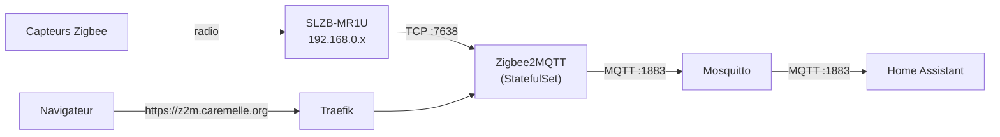

# Zigbee2MQTT

Passerelle Zigbee vers MQTT, dans le namespace `home-assistant`.



- Chart officiel `zigbee2mqtt` (https://charts.zigbee2mqtt.io), version épinglée dans l'Application.
- Values : `helm/zigbee2mqtt/values.yaml`. Application : `argocd-apps/zigbee2mqtt-app.yml`.
- Coordinateur joint en **TCP** : pas de passthrough USB, pas de `privileged`.

## Dongle SLZB-MR1U

Le SLZB-MR1U a deux radios, configurées dans SLZB OS (page *Mode*) :

| Radio | Puce | Rôle | Port socket |
|---|---|---|---|
| 1 | EFR32MG21 | Thread (OTBR) | 6638 |
| 2 | CC2652P7 | **Zigbee Coordinator** (Z2M, `adapter: zstack`) | **7638** |

- IP `192.168.0.35` : réservation DHCP sur la box (hors pool MetalLB `.151-.170`).
- Z2M : `tcp://192.168.0.35:7638`, `adapter: zstack` (bloc `zigbee2mqtt.serial` des values).
- Une seule radio doit être coordinateur Zigbee pour Z2M (sinon deux réseaux distincts).

## Déploiement

1. **AdGuard** : réécriture DNS `z2m.caremelle.org` vers Traefik (`192.168.0.151`).
2. Commiter et pousser sur `main` : ArgoCD synchronise l'Application.
3. Contrôler : `kubectl logs -n home-assistant statefulset/zigbee2mqtt` (voir « Vérifications »).

## Secrets

`secret.yaml` est monté depuis le SealedSecret `zigbee2mqtt-secret` (dans `extraResources`) et référencé dans la config par `'!secret clé'` :

| Clé | Usage |
|---|---|
| `mqtt_user`, `mqtt_password` | compte `zigbee2mqtt` de Mosquitto |
| `network_key` | clé de chiffrement du réseau Zigbee (16 octets) |
| `auth_token` | jeton de connexion à l'interface web |

La `network_key` est fixée : avec `GENERATE`, une clé serait recréée si la config était perdue, et tous les appareils seraient à ré-appairer. **Sauvegarde-la** (gestionnaire de mots de passe).

Si le mot de passe MQTT change côté Mosquitto, régénérer ce SealedSecret aussi (`kubeseal --controller-name=sealed-secrets --controller-namespace=sealed-secrets`, clé `secret.yaml`) et redémarrer le pod.

## Choix à connaître

| Sujet | Choix | Pourquoi |
|---|---|---|
| Canal Zigbee | 25 | hors des canaux Wi-Fi 1/6/11. Le changer impose de ré-appairer tout |
| Sécurité | non-root (1000), `drop: [ALL]`, pas de `privileged` | le défaut du chart est `privileged` + `SYS_ADMIN`, inutile en TCP |
| Service | ClusterIP | le défaut (`LoadBalancer`) prendrait une IP MetalLB |
| RAM | requête 200 Mi, limite 400 Mi | le défaut (600 Mi) est trop pour le worker (4 Go) |
| Stockage | PVC `local-path` 1 Gi | contient `database.db`, `coordinator_backup.json`, `configuration.yaml` |
| Renovate | pas d'automerge | un redémarrage coupe brièvement le Zigbee |
| Interface web | `auth_token` | l'UI n'a pas d'authentification par défaut |

## Vérifications

```bash
kubectl get pods -n home-assistant | grep zigbee2mqtt
kubectl logs -n home-assistant statefulset/zigbee2mqtt --tail=50
```

Attendu dans les logs : connexion MQTT établie, adaptateur zstack détecté, `Zigbee2MQTT started`.

| Symptôme | Cause probable |
|---|---|
| Erreur de lecture de `!secret` | syntaxe de référence : vérifier la doc Z2M, et que `secret.yaml` est bien monté dans `/app/data` |
| `Permission denied` sur `/app/data` | droits du volume avec l'utilisateur 1000 (`fsGroup`) |
| Échec de connexion à l'adaptateur | mauvais port (6638/7638) ou mauvais `adapter` |
| `not authorised` côté Mosquitto | mot de passe MQTT du SealedSecret désaligné |

## Sauvegarde

Le PVC contient `coordinator_backup.json` et `database.db` : les perdre oblige à ré-appairer les appareils. Aucune sauvegarde automatique n'est en place pour l'instant (à prévoir).
